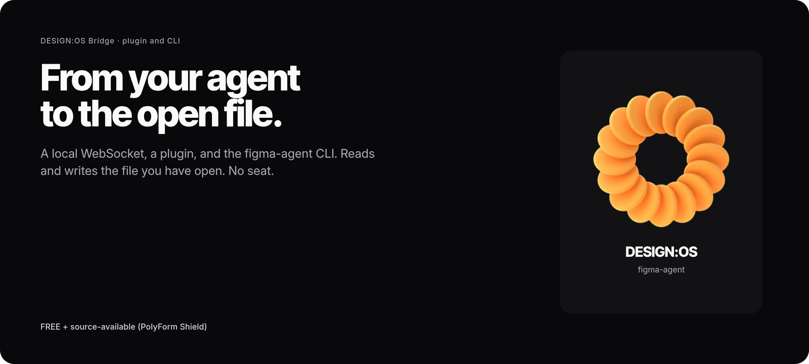
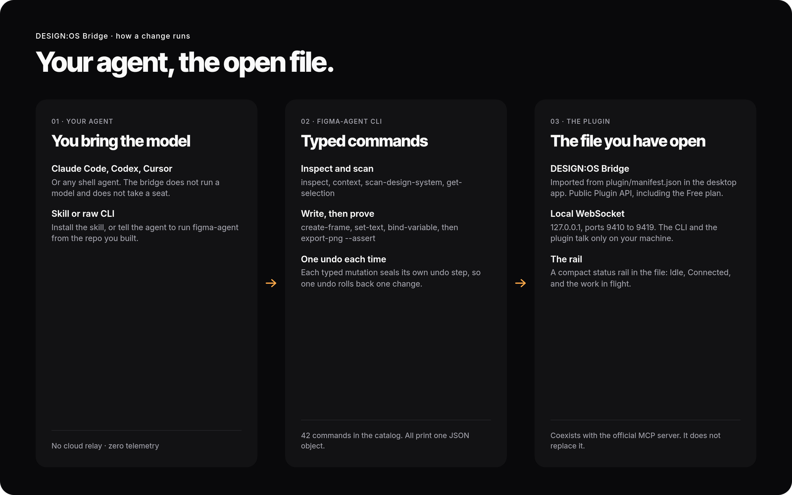
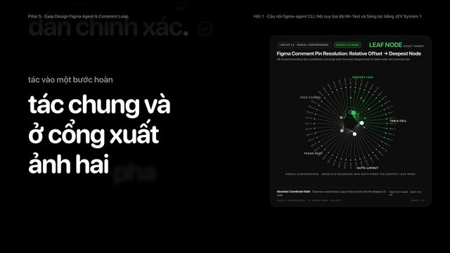

# DESIGN:OS Bridge

<p>
<picture>
  <source media="(prefers-color-scheme: dark)" srcset="assets/readme/cover-dark.png">
  <source media="(prefers-color-scheme: light)" srcset="assets/readme/cover-light.png">
  
</picture>
</p>

**A plugin and a CLI so your coding agent can read and edit the Figma file you have open.** DESIGN:OS Bridge runs in Figma Desktop, including on the Free plan. The `figma-agent` CLI talks to the plugin over a local WebSocket on `127.0.0.1` (ports 9410 to 9419). One undo step per mutation. No seat, no access token, no model inside the bridge. You bring your own agent: Claude Code, Codex, Cursor, or any shell.

The repository is [`jangtrinh/design-os-figma-plugin`](https://github.com/jangtrinh/design-os-figma-plugin). The product name is DESIGN:OS Bridge.

FREE + source-available ([PolyForm Shield 1.0.0](LICENSE)).

<p>
  <a href="#quickstart">Quickstart</a> · <a href="#use-with-claude-code-cursor-and-codex">Use with your agent</a> · <a href="#faq">FAQ</a> · <a href="#how-it-works">How it works</a> · <a href="#install">Install</a> · <a href="#limits">Limits</a>
</p>

<p align="left">
  <a href="LICENSE"></a>
  <a href="https://jangtrinh.github.io/design-os-figma-plugin/"></a>
</p>

## Quickstart

```bash
git clone https://github.com/jangtrinh/design-os-figma-plugin.git
cd design-os-figma-plugin
npm ci && npm run build          # Node.js 22; builds cli/dist/figma-agent.js and plugin/code.js
node cli/dist/figma-agent.js status --peek
```

Then, in Figma Desktop: **Plugins → Development → Import plugin from manifest…** and pick `plugin/manifest.json`. Open the plugin in a scratch file first.

**In Claude Code**, you can also install the plugin from the marketplace:

```text
/plugin marketplace add jangtrinh/design-os-figma-plugin
/plugin install design-os-figma-plugin@design-os-figma-plugin
```

Check the connection from the repository root:

```bash
node "$PWD/cli/dist/figma-agent.js" status --wait --timeout 60
```

## The rail

The plugin shows a compact status rail in the file you have open. This is a real capture of that rail, not a mock.

<p>
  
</p>

<p>
  
</p>

Idle, Connected, and the work in flight. The orb, the sentence, and a caret to expand.

## Use with Claude Code, Cursor and Codex

The bridge has two parts: a **plugin** that runs inside Figma Desktop, and the **`figma-agent` CLI** that your agent runs in a shell. The CLI talks to the plugin over a local WebSocket on `127.0.0.1` (ports 9410 to 9419). No model runs inside the bridge.

**Set up once (any agent)**

```bash
git clone https://github.com/jangtrinh/design-os-figma-plugin.git
cd design-os-figma-plugin
npm ci && npm run build
```

In Figma Desktop: **Plugins → Development → Import plugin from manifest…**, then choose `plugin/manifest.json`.

```bash
node "$PWD/cli/dist/figma-agent.js" status --wait --timeout 60
```

**Claude Code**

```text
/plugin marketplace add jangtrinh/design-os-figma-plugin
/plugin install design-os-figma-plugin@design-os-figma-plugin
```

Or write the skill from your built CLI: `node cli/dist/figma-agent.js install-skill --folder ~/.claude/skills --with-craft --yes`.

**Cursor**

Cursor loads skills from `~/.cursor/skills/` and `~/.agents/skills/` ([Cursor docs](https://cursor.com/docs/skills)).

```bash
node cli/dist/figma-agent.js install-skill --folder ~/.cursor/skills --with-craft --yes
```

Then ask in Agent chat: "Inspect my current selection with the design-os-figma-agent skill."

**Codex**

Codex scans `~/.agents/skills/` for user skills ([Codex skills docs](https://developers.openai.com/codex/skills)).

```bash
node cli/dist/figma-agent.js install-skill --folder ~/.agents/skills --with-craft --yes
```

Without a skills folder, tell any shell agent to run `node "$PWD/cli/dist/figma-agent.js" status` and then read its command list.

## FAQ

**Does it replace the official MCP server?** No. They coexist. The official server is the better tool for Code Connect, cross-library search and working with Figma Desktop closed. This bridge reads and writes the open file through the Public Plugin API.

**Does it need a paid seat?** No seat or access token for the bridge. It needs edit access to the file for writes, and Figma Desktop running the imported plugin.

**Is it on the Community listing?** No. It is a development plugin imported from this repository.

**Does it run or pay for a model?** No. You choose and pay for your own agent or provider.

**Can the agent undo its own work?** Yes. Each typed mutation seals its own undo step, so one undo rolls back one change.

**What licence is it under?** It is source-available under [PolyForm Shield 1.0.0](LICENSE). The [`LICENSE`](LICENSE) file governs.

## How it works

<p>
<picture>
  <source media="(prefers-color-scheme: dark)" srcset="assets/readme/flow-dark.png">
  <source media="(prefers-color-scheme: light)" srcset="assets/readme/flow-light.png">
  
</picture>
</p>

The CLI exposes **42 commands**, from the catalog in `cli/src/command-catalog.ts`. A short sample:

| Command | What it does |
| :--- | :--- |
| `status` | Broker and plugin connection. `--peek` never spawns a broker. `--wait` can. |
| `inspect` · `context` · `get-selection` | Read the current selection or a node, compacted for an agent's context window. |
| `scan-design-system` | Scan tokens and components in the open file. |
| `create-frame` · `set-text` · `bind-variable` · `set-autolayout` | Typed writes. Each one seals its own undo step. |
| `export-png --assert` | A PNG snapshot, checked, before or after a mutation. |
| `install-skill` · `install-hook` | Install the agent skill or a hook into a project. |

Every command prints one JSON object to stdout and exits 0, or `{error:{code,message}}` and exits 1. The full list is in [`docs/operations.md`](docs/operations.md) and in `figma-agent --help`.

The official write MCP is plan-gated. This bridge is a local alternative for the file you already have open, and it coexists with that server. See [the official rate limits](https://developers.figma.com/docs/figma-mcp-server/rate-limits-access/) for what the official server requires.

Nothing in the bridge sends data off your machine. See [`PRIVACY.md`](PRIVACY.md).

## Install

Choose the setup that matches your agent. The canonical skill is [`skills/design-os-figma-craft/SKILL.md`](skills/design-os-figma-craft/SKILL.md). After a build, `install-skill` writes it for you. The copies below are for a manual install.

### Claude Code

```text
/plugin marketplace add jangtrinh/design-os-figma-plugin
/plugin install design-os-figma-plugin@design-os-figma-plugin
```

### OpenAI Codex

```bash
git clone https://github.com/jangtrinh/design-os-figma-plugin.git /tmp/design-os-figma-plugin
mkdir -p ~/.codex/skills/design-os-figma-craft ~/.codex/prompts
cp -R /tmp/design-os-figma-plugin/skills/design-os-figma-craft/* ~/.codex/skills/design-os-figma-craft/
cp /tmp/design-os-figma-plugin/prompts/doctor.md ~/.codex/prompts/design-os-figma-craft-doctor.md
rm -rf /tmp/design-os-figma-plugin
```

### Gemini CLI and Google Antigravity

```bash
git clone https://github.com/jangtrinh/design-os-figma-plugin.git /tmp/design-os-figma-plugin
mkdir -p ~/.gemini/skills/design-os-figma-craft
cp -R /tmp/design-os-figma-plugin/skills/design-os-figma-craft/* ~/.gemini/skills/design-os-figma-craft/
rm -rf /tmp/design-os-figma-plugin
```

### OpenCode, Cursor, Windsurf and other agent harnesses

```bash
git clone https://github.com/jangtrinh/design-os-figma-plugin.git /tmp/design-os-figma-plugin
mkdir -p ~/.agents/skills/design-os-figma-craft
cp -R /tmp/design-os-figma-plugin/skills/design-os-figma-craft/* ~/.agents/skills/design-os-figma-craft/
rm -rf /tmp/design-os-figma-plugin
```

<details>
<summary>Verify or uninstall</summary>

**Verify:**

```bash
node cli/dist/figma-agent.js status --peek
python3 scripts/self_check.py
```

Or run `/doctor` inside Claude Code or Codex.

**Uninstall the skill copies:**

```bash
rm -rf ~/.claude/skills/design-os-figma-craft ~/.codex/skills/design-os-figma-craft ~/.gemini/skills/design-os-figma-craft ~/.cursor/skills/design-os-figma-craft ~/.agents/skills/design-os-figma-craft
```

</details>

## Limits

- The plugin has to be open in Figma Desktop, with the file you want to edit already open. It cannot talk to a file that is only in the cloud.
- It does not replace Code Connect, cross-library search, or work that needs the official Figma MCP server with Figma Desktop closed.
- It is not listed in the Community catalog. You import `plugin/manifest.json` from this repository.
- Converting an arbitrary live HTML page through a third-party scraper is out of scope. Use image fills or the typed frame builders, including the `html-to-figma` command in this CLI when that is the right tool.

## Watch

DESIGN:OS Bridge is FREE + source-available (PolyForm Shield). One episode of the Autonomous Design Agent series from the [design:os by Jang](https://www.youtube.com/@designosbyjang) channel (Vietnamese, with English terms):

<p align="left">
  <a href="https://www.youtube.com/watch?v=c6yc314JsTI"></a>
</p>

Watch [Autonomous Design Agent Ep. 5: Two-way bridge: One Comment, the AI Fixes Design and Code](https://www.youtube.com/watch?v=c6yc314JsTI) (2:44) for how one review comment can drive changes to both the design file and the code through DESIGN:OS Bridge.

More episodes: [Autonomous Design Agent playlist](https://www.youtube.com/playlist?list=PLAgHz-2MRSJw).

## DESIGN:OS

This is one of the DESIGN:OS tools. The others: [Studio](https://github.com/jangtrinh/design-os-studio), [CLI](https://github.com/jangtrinh/design-os), [3D Blender](https://github.com/jangtrinh/design-os-3d-blender), [SVG Animation](https://github.com/jangtrinh/design-os-svg-animation), [Code2Flow](https://github.com/jangtrinh/design-os-code2flow), [Knowledge Builder](https://github.com/jangtrinh/design-os-knowledge-builder) and more on [jangtrinh.github.io](https://jangtrinh.github.io/).

| Engine | Live docs | Repository |
| :--- | :--- | :--- |
| DESIGN:OS CLI | [jangtrinh.github.io/design-os](https://jangtrinh.github.io/design-os/) | [`jangtrinh/design-os`](https://github.com/jangtrinh/design-os) |
| Knowledge Builder | [jangtrinh.github.io/design-os-knowledge-builder](https://jangtrinh.github.io/design-os-knowledge-builder/) | [`jangtrinh/design-os-knowledge-builder`](https://github.com/jangtrinh/design-os-knowledge-builder) |
| DESIGN:OS Bridge | [jangtrinh.github.io/design-os-figma-plugin](https://jangtrinh.github.io/design-os-figma-plugin/) | [`jangtrinh/design-os-figma-plugin`](https://github.com/jangtrinh/design-os-figma-plugin) |
| SVG Animation Engine | [jangtrinh.github.io/design-os-svg-animation](https://jangtrinh.github.io/design-os-svg-animation/) | [`jangtrinh/design-os-svg-animation`](https://github.com/jangtrinh/design-os-svg-animation) |
| 3D Blender | [jangtrinh.github.io/design-os-3d-blender](https://jangtrinh.github.io/design-os-3d-blender/) | [`jangtrinh/design-os-3d-blender`](https://github.com/jangtrinh/design-os-3d-blender) |
| OPAH ONE Drone | [jangtrinh.github.io/design-os-drone-showcase](https://jangtrinh.github.io/design-os-drone-showcase/) | [`jangtrinh/design-os-drone-showcase`](https://github.com/jangtrinh/design-os-drone-showcase) |
| GitHub Pages Engine | [jangtrinh.github.io/design-os-github-page](https://jangtrinh.github.io/design-os-github-page/) | [`jangtrinh/design-os-github-page`](https://github.com/jangtrinh/design-os-github-page) |
| Apple Design OS | [jangtrinh.github.io/design-os-apple](https://jangtrinh.github.io/design-os-apple/) | [`jangtrinh/design-os-apple`](https://github.com/jangtrinh/design-os-apple) |
| Agent Teacher | [jangtrinh.github.io/design-os-pedagogy](https://jangtrinh.github.io/design-os-pedagogy/) | [`jangtrinh/design-os-pedagogy`](https://github.com/jangtrinh/design-os-pedagogy) |
| Origami CAD | [jangtrinh.github.io/design-os-origami](https://jangtrinh.github.io/design-os-origami/) | [`jangtrinh/design-os-origami`](https://github.com/jangtrinh/design-os-origami) |
| Voice UX Architecture | [jangtrinh.github.io/design-os-voice-ux](https://jangtrinh.github.io/design-os-voice-ux/) | [`jangtrinh/design-os-voice-ux`](https://github.com/jangtrinh/design-os-voice-ux) |
| Code2Flow | [jangtrinh.github.io/design-os-code2flow](https://jangtrinh.github.io/design-os-code2flow/) | [`jangtrinh/design-os-code2flow`](https://github.com/jangtrinh/design-os-code2flow) |
| Generative UI | [jangtrinh.github.io/design-os-generative-ui](https://jangtrinh.github.io/design-os-generative-ui/) | [`jangtrinh/design-os-generative-ui`](https://github.com/jangtrinh/design-os-generative-ui) |

Docs: [jangtrinh.github.io/design-os-figma-plugin](https://jangtrinh.github.io/design-os-figma-plugin/) · Changelog: [`CHANGELOG.md`](CHANGELOG.md) · Index for AI agents: [`llms.txt`](llms.txt)

## Contributing and license

- [`CONTRIBUTING.md`](CONTRIBUTING.md) · [`CODE_OF_CONDUCT.md`](CODE_OF_CONDUCT.md) · [`SECURITY.md`](SECURITY.md) · [`PRIVACY.md`](PRIVACY.md)
- [PolyForm Shield 1.0.0](LICENSE). FREE to use and modify, including for paid client work; you may not resell it or build a competing product from it.

## Built by

Built by [Jang Trịnh](https://github.com/jangtrinh), creative technologist and autonomous system architect.

[GitHub](https://github.com/jangtrinh) · [LinkedIn](https://www.linkedin.com/in/jangtrinh/) · [Hub](https://jangtrinh.github.io/) · [YouTube](https://www.youtube.com/@designosbyjang) · [X](https://x.com/Jangtrinhvn)

If DESIGN:OS Bridge saves you time, a star on GitHub helps other engineers and AI agents find it.

<p align="left">
  <a href="https://buymeacoffee.com/jangtrinh">
    
  </a>
</p>
